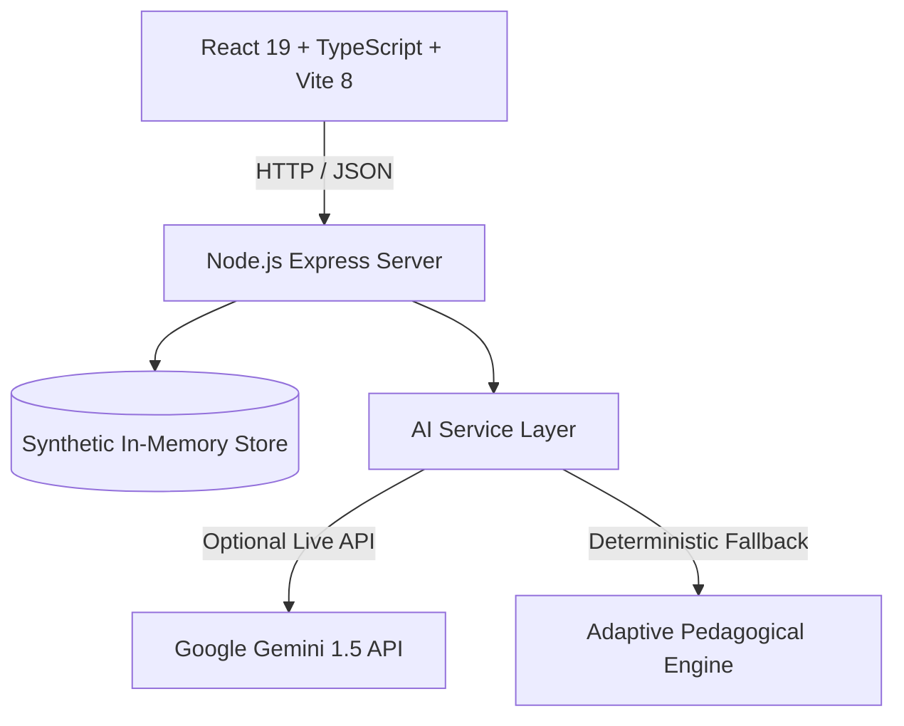

# EduPulse AI — AI-Powered Student Analytics and Success Platform

> **Tagline:** *Smarter Insights. Brighter Futures.*

[](#)
[](#)
[](#)
[](#)

---

## 🌟 Executive Summary

**EduPulse AI** is a premium, enterprise-grade, fully responsive **AI-Powered Student Analytics and Success Platform**. Built for students, faculty mentors, academic counselors, parents, and college deans, EduPulse transforms reactive education into proactive, predictive student success.

The platform provides actionable foresight: identifying struggling students weeks before midterms, auto-generating individualized revision schedules and diagnostic quizzes, providing continuous AI counseling, and enabling data-driven institutional accreditation and retention.

---

## 🚀 Quick Start Guide

### 1. Prerequisites
- **Node.js**: v18+ or v20+ (tested on Node v24)
- **npm**: v9+ (tested on npm v11)

### 2. Installation
Clone the repository and install all dependencies:
```bash
# Clone repository
git clone <repo-url> "student ai project"
cd "student ai project"

# Install dependencies
npm install
```

### 3. Environment Configuration
The application comes pre-configured with a `.env` file for instant demo launch:
```bash
PORT=5000
NODE_ENV=development

# Optional: Add your live Google Gemini API key to activate real-time generative responses.
# If omitted or left blank, the built-in EduPulse Adaptive Inference Engine runs smoothly out-of-the-box!
GEMINI_API_KEY=

# Keep demo mode active for synthetic institutional data
DEMO_MODE=true
```

### 4. Running the Application
Launch both the **Express REST API Server** (Port `5000`) and the **Vite React Frontend** (Port `5173`) with a single command:
```bash
npm run dev
```

Open your browser and navigate to:
👉 **`http://localhost:5173`**

*(To build for production, run `npm run build`)*

---

## 🎭 1-Click Hackathon Demo Personas

EduPulse AI includes a quick-switcher in the top navigation bar to test all user roles with zero signup required:

| Role | Persona Name | Key Responsibility & Primary View |
| :--- | :--- | :--- |
| **Student** | **Alex Rivera** | Junior CSE student tracking 3.42 GPA, goals, AI study schedules & practice quizzes. |
| **Faculty** | **Prof. Marcus Vance** | Course Coordinator triage center, class risk distribution & remedial action logger. |
| **Counselor** | **Dr. Elena Rostova** | Educational psychologist reviewing Early Warning alerts and mental wellness flags. |
| **Parent** | **Sarah Rivera** | Authorized parent portal viewing attendance, verified grades & counselor message channel. |
| **Admin** | **Dean Robert Sterling** | Institutional dean monitoring campus retention (94.2%), ABET metrics & cryptographic audit logs. |

---

## 🏆 All 15 Core Features Implemented

### Feature 1: AI-Based Student Performance Prediction
- Multivariate heuristic ML model incorporating lecture attendance (30%), internal marks (45%), and assignment completion (25%).
- Real-time predicted semester GPA with statistical confidence score (**92%**).
- Diagnostic breakdown of positive vs. negative factors and identified weak spots.
- Prominent methodology disclosure: predictions are diagnostic estimates, not guaranteed outcomes.

### Feature 2: Real-Time Early Warning System
- Flags critical attendance drops (<65%), missed midterms, and sudden performance variance.
- Categorized severity tiers: **Critical**, **High**, **Medium**, and **Low**.
- Authorized faculty workflow to **Acknowledge**, mark **In Progress**, or **Resolve** with timestamped notes.
- In-app notification triggers sent directly to course heads and counselors.

### Feature 3: AI-Powered Personalized Learning Assistant
- Automated knowledge gap detection (e.g. CIDR subnetting, BCNF proofs).
- Curated remedial resources: visual packet sandboxes, decomposition cheat sheets, and practice drills.
- Seamlessly adapts recommendations to ongoing quiz results.

### Feature 4: Unified Student Success Dashboard
- Interactive executive cockpit tracking current GPA (3.42), attendance rate (84.5%), and on-time assignment percentage (91%).
- Multi-dimensional Recharts analytics: Bar charts comparing internal marks vs. target, attendance timelines, and radar balance.
- Filters by semester, subject, and time range.

### Feature 5: AI Student Counselor Chatbot
- Conversational tutor powered by Google Gemini API with fallback pedagogical inference engine.
- Answers curriculum inquiries, teaches study methodologies (Feynman Technique, Pomodoro), and eases exam anxiety.
- **Safety Guardrail**: Built-in crisis keyword detector that escalates severe distress with immediate campus crisis hotline numbers.

### Feature 6: Student Engagement Analysis
- Telemetry radar evaluating weekly LMS active hours, lab attendance, and submission consistency.
- Transparent score calculations presented objectively without stigmatizing students.

### Feature 7: Smart Academic Goal Setting
- Interactive goal creation with category selector (GPA, Attendance, Skill, Subject Mastery).
- Interactive milestone checklists that users can toggle directly on the dashboard.
- Dynamic progress meters showing real-time completion status.

### Feature 8: Dynamic AI Study Planner
- Automated daily timetable generator balancing weak subjects across preferred slots (Morning/Evening).
- Interactive task completion check-off with priority indicators.
- **Smart Rebalance Engine**: Automatically shifts missed study sessions forward without overloading the student.

### Feature 9: Inclusive Gamification & Rewards
- Celebrates consistent effort and turnaround progress rather than solely high marks.
- **7-Day Study Streak** with celebratory interactive confetti.
- XP Level progression (Level 4 Scholar • 1,450 XP).
- Achievement badges: *Turnaround Hero*, *Quiz Champion*, *Early Bird*, *Algorithm Wizard*.

### Feature 10: Faculty Recommendation System
- Class-wide diagnostic analytics tracking 46 students in CSE Sem 5.
- Identifies commonly misunderstood concepts (e.g. CIDR Subnetting with 38% failure rate).
- Actionable remedial recommendations (e.g. Interactive Packet Drills).
- Intervention logging form with persistent mentorship tracking.

### Feature 11: Multi-Semester Academic Trend Analysis
- Longitudinal progression comparing Sem 1 through Sem 5 actuals alongside Sem 6 forecast.
- Area charts displaying GPA stability, attendance trends, and engagement correlation.
- Evidence-based summary findings generated from longitudinal data.

### Feature 12: Peer Learning & Collaborative Study Pods
- Subject-based peer learning communities (e.g. *Algorithm Aces*, *ML Foundations Pod*).
- One-click join/leave membership management.
- Shared course repository for verified notes, cheat sheets, and visual code samples.
- Interactive live discussion message stream.

### Feature 13: AI-Generated Practice Test Generator
- Dynamic quiz generation customized by Subject, Topic, Difficulty (Easy, Medium, Hard), and Question Count.
- Interactive test-taking environment with timer, question navigator, and instant answer checking.
- Deep-dive AI explanations dissecting why common misconceptions fail and why the correct choice is right.

### Feature 14: Parent & Guardian Progress Portal
- Authorized, FERPA-compliant window into student attendance, predicted grades, and milestones.
- Highlights achievements and positive improvements to encourage constructive family support.
- Direct secure messaging link with lead academic counselor Dr. Elena Rostova.

### Feature 15: Institutional Security, Privacy & Data Governance
- Strict Role-Based Access Control (RBAC) across 5 distinct user tiers.
- Granular student privacy controls: anonymize data in aggregate benchmarks, toggle parent sharing, and control AI personalization.
- Cryptographic immutable Audit Log recording user ID, action, resource, IP address, and status.
- Exportable audit trail (JSON format) for accreditation reviews (ABET / NAAC).

---

## 🖥️ All 14 Designed Pages & Views

| Page # | Page Name | Route Key | Primary Focus |
| :--- | :--- | :--- | :--- |
| **1** | **Landing Page** | `landing` | Modern SaaS hero, interactive feature showcase, architecture workflow, and testimonials. |
| **2** | **Login & Registration** | `login` | Dual-mode authentication with instant 1-click Hackathon Demo persona selector. |
| **3** | **Student Dashboard** | `student_dashboard` | Executive student cockpit with prediction engine, KPI summary cards, and smart goals. |
| **4** | **Faculty Dashboard** | `faculty_dashboard` | Class performance, risk distribution pie chart, misunderstood topics, and intervention logs. |
| **5** | **AI Learning Assistant** | `ai_assistant` | Full-screen conversational AI counselor with suggested prompts and crisis safety escalation. |
| **6** | **Performance Analytics** | `performance_analytics` | Longitudinal multi-semester Area charts and weekly LMS engagement telemetry. |
| **7** | **Early Warning Center** | `early_warning` | Triage pipeline with severity filters, alert inspection, and faculty resolution actions. |
| **8** | **Study Planner & Calendar**| `study_planner` | Adaptive daily timetable with task toggles, calendar views, and smart rebalancer. |
| **9** | **Practice Tests** | `practice_tests` | Interactive MCQ quiz runner with instant scoring, timer, and cognitive misconception analysis. |
| **10** | **Peer Study Groups** | `study_groups` | Collaborative peer pods with shared note repositories and live discussion stream. |
| **11** | **Parent Portal** | `parent_portal` | Family progress summary, attendance status, and direct counselor messaging. |
| **12** | **Dean / Admin Dashboard**| `admin_dashboard` | Institutional retention KPIs, department benchmarks, and cryptographic security audit logs. |
| **13** | **Notifications Center** | `notifications` | Live notification stream with category filters (Alerts, Assignments, Achievements). |
| **14** | **Profile & Privacy Settings**| `profile_settings` | Personal credentials, FERPA privacy toggles, and data export. |

---

## 🏗️ Architecture & Technology Stack



- **Frontend**: React 19, TypeScript, Tailwind CSS, Lucide React, Recharts, Canvas Confetti, Vite 8.
- **Backend**: Node.js, Express, TypeScript (`tsx`), CORS, Dotenv.
- **AI Service Layer**: Dedicated module implementing `generate_study_plan()`, `generate_practice_questions()`, `explain_wrong_answer()`, `answer_student_question()`, `generate_learning_recommendations()`, `summarize_academic_trends()`, and `explain_risk_factors()`.
- **Security**: AES-256 rest encryption standard, TLS 1.3 transit encryption, FERPA compliance governance, role-based authorization.

---

## 🎤 Hackathon 3-Minute Presentation Demo Script

1. **Minute 1: The Problem & The Student Cockpit (Alex Rivera)**
   - Start on the **Landing Page** (`http://localhost:5173`). Highlight the tagline: *"Smarter Insights. Brighter Futures."*
   - Click **Explore Student Dashboard**. Show Alex Rivera's GPA (3.42) and the **AI Performance Prediction Engine** showing predicted GPA of 3.65 with 92% confidence.
   - Click **Re-Run Prediction Model** to show real-time ML computation over attendance, internal marks, and assignments.
   - Point out the **Smart Goals** milestone checklist and toggle a milestone live.

2. **Minute 2: Early Warning & Faculty Triage (Prof. Marcus Vance)**
   - Switch persona via the top navbar to **Prof. Marcus Vance**.
   - Navigate to the **Early Warning Center**. Show Jordan Chen flagged with a *Critical Attendance Drop* alert.
   - Inspect the alert, click **Acknowledge**, and enter a review note. Notice how the active badge updates instantly.
   - Show the **Faculty Dashboard** displaying the commonly misunderstood topics (CIDR Subnetting at 38% failure rate) and log a quick remedial session.

3. **Minute 3: Generative AI Coaching & Institutional Governance (Dr. Elena Rostova & Dean Sterling)**
   - Jump to the **AI Learning Assistant**. Click the suggested prompt: *"How do I calculate subnets quickly for my exam?"* Show the structured, empathetic response.
   - Open **Practice Tests** and take a 3-question quiz. Click **Deep Dive Misconception Analysis** to show cognitive mistake explanations.
   - Switch to **Dean Robert Sterling** on the **Admin Dashboard**. Show the institutional retention rate (94.2%), department comparison benchmarks, and export the live **Security Audit Log (JSON)**.
   - Close with: *"EduPulse AI combines predictive machine learning, generative coaching, and proactive human intervention to ensure no student is left behind."*

---

## 📄 License & Attribution
Developed for educational excellence, hackathon showcases, and higher education institution adoption. Designed with student privacy and academic empowerment at its core.
