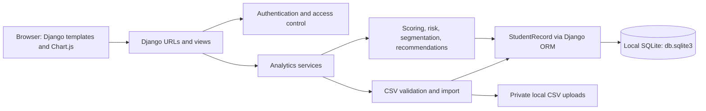

# CampusIQ AI

CampusIQ AI is a Django-based student analytics platform for campus administrators, faculty advisors, and student support teams. It brings together academic, attendance, engagement, and placement-readiness signals into a clear dashboard that helps identify at-risk students and explain why intervention may be needed.

## Tagline
Predict, Explain & Improve Student Success.

## Overview
The project is a full-stack analytics dashboard designed for higher-education support workflows. It includes a protected login experience, student directory search, risk analysis, segmentation, CSV import, and explainable success scoring for institutions that need actionable student insights without black-box decision-making.

## Key features
- Professional authentication flow using Django's built-in auth system
- Login and logout with secure session handling and CSRF protection
- Protected student dashboard and analytics pages via `login_required`
- Weighted student success scoring model
- Academic risk, placement-risk, and incomplete-data detection
- Searchable student directory with detailed profile views
- CSV upload, validation, and demo data loading
- Student segmentation and recommendation summaries
- Organized dashboard charts and KPI cards

## Tech stack
- Python 3
- Django 6.1.2
- SQLite
- Pandas and NumPy
- HTML, CSS, and JavaScript
- Django templates and Chart.js

## Project structure
- `analytics/`: models, views, services, forms, and tests
- `campusiq_ai/`: Django settings and project URL configuration
- `templates/`: dashboard and auth templates
- `static/`: CSS and frontend assets
- `data/`: demo CSV files and upload template
- `docs/`: architecture, scoring, and demo documentation

## Architecture


- Django handles routing, username/password authentication, sessions, CSRF protection, and page access.
- Analytics services keep scoring, risk analysis, segmentation, recommendations, and CSV validation separate from view code.
- `StudentRecord` is persisted through Django ORM in the existing local SQLite database.
- CSV files are stored in `private_uploads/csv_uploads/`; validated records are then imported into SQLite.
- Django templates render the dashboard, student directory, profiles, and analysis pages; Chart.js displays dashboard charts.

## Local setup

### 1. Create and activate a virtual environment
```powershell
py -m venv .venv
.\.venv\Scripts\Activate.ps1
```

### 2. Install dependencies
```powershell
python -m pip install -r requirements.txt
```

### 3. Apply database migrations
```powershell
python manage.py migrate
```

### 4. Create a superuser account
```powershell
python manage.py createsuperuser
```
Follow the prompts to create a username, email, and password. This account can be used to sign in through the app's login page.

### 5. Load demo data
```powershell
python manage.py load_demo_data
```

### 6. Start the application
```powershell
python manage.py runserver
```

Open the app in your browser:
- http://127.0.0.1:8000/

The login page is available at:
- http://127.0.0.1:8000/accounts/login/

## Authentication behavior
- Unauthenticated users are redirected to the login page when attempting to access the dashboard or student-data pages.
- Login uses Django's built-in `AuthenticationForm` and session-based auth.
- Logout is handled with a secure POST form and redirects back to the login screen.
- The app uses Django's password hashing and does not store plaintext credentials.
- A remember-me checkbox sets a longer session expiry for convenience while still using Django sessions securely.
- Authentication does not require email verification.

## Local data storage
- Development uses the existing SQLite database at `db.sqlite3` through Django ORM; no cloud database is configured.
- Uploaded CSV files are stored locally under `private_uploads/csv_uploads/` and are not served as public media.
- Uploads are checked for CSV extension, non-empty content, and a 10 MB size limit before storage. Student rows and values are validated before database import.
- No Supabase migration has been made. Any future database change should be agreed before migrating existing data.

## Demo workflow
1. Open the login page at `/accounts/login/`.
2. Sign in with your local Django superuser or a created user account.
3. Review the protected dashboard KPI cards and charts.
4. Browse the student directory and open student detail pages.
5. Upload new student data from CSV or inspect segmentation and risk outputs.

## Troubleshooting
- If `python-dotenv` is missing, install dependencies again with `python -m pip install -r requirements.txt`.
- If pages redirect unexpectedly, ensure you are signed in through the Django auth flow and not using a hardcoded credential.
- If you see database issues, run `python manage.py migrate` after pulling changes.

## Documentation
Additional project docs can be found in the `docs/` folder, including the architecture overview, problem statement, demo script, and scoring methodology.
