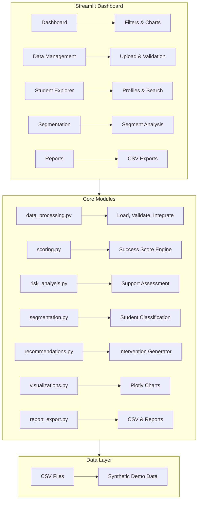

# 🎓 EduPredict AI — Student Analytics Platform

> **byteXL HacXLerate 2026 — Problem Statement 4 by KPMG**

EduPredict AI is a comprehensive student analytics web application that integrates academic, attendance, LMS, skills, engagement, and placement data to calculate transparent **Student Success Scores**, identify students who may need support, explain results, and recommend practical interventions.

> ⚠️ **Important Disclaimer:** The Student Success Score is a **prototype indicator** for hackathon demonstration purposes. It is NOT a validated predictive model and should not be used as the sole basis for academic or placement decisions. Human review is essential.

---

## ✨ Features

| Feature | Description |
|---|---|
| **Dashboard** | KPI metrics, interactive Plotly charts, auto-generated insights, department comparisons |
| **Data Integration** | CSV upload with validation, duplicate detection, missing value summaries |
| **Student Explorer** | Searchable/filterable student table with detailed profiles |
| **Success Scoring** | Configurable weighted composite score (0–100) with transparent calculations |
| **Risk Analysis** | Independent academic & placement support assessment with explainable factors |
| **Segmentation** | Rule-based student classification into actionable groups |
| **Recommendations** | Practical, data-driven intervention suggestions with reasons |
| **Reports & Exports** | Downloadable CSV exports, methodology documentation |

---

## 🏗️ Architecture



---

## 📊 Scoring Methodology

### Student Success Score (0–100)

A weighted composite of normalized indicators:

| Indicator | Default Weight | Source | Scale |
|---|---|---|---|
| Academic Performance | 25% | Average marks across subjects | 0–100 |
| Attendance | 20% | Attendance percentage | 0–100 |
| LMS & Assignments | 15% | Completion rate (60%) + score (40%) | 0–100 |
| Placement Readiness | 20% | Average of aptitude, coding, communication, interview | 0–100 |
| Skills Assessment | 10% | Average proficiency (1–10 → normalized) | 0–100 |
| Engagement & Feedback | 10% | Satisfaction + collaboration (1–10 → normalized) | 0–100 |

### Missing Data Handling
- When indicators are missing, weights are **re-normalized** across available indicators
- Missing data is **never replaced with zero**
- If **no** valid indicators exist, score is "Unavailable" (not 0)
- Data completeness percentage is always displayed

### Configurable Weights
Weights can be adjusted in the Reports & Exports page. Changes trigger immediate score recalculation.

---

## 🔍 Risk Analysis Rules

### Academic Support
| Status | Rule |
|---|---|
| Support Recommended | 2+ concerns (marks <45%, attendance <65%, completion <50%) |
| Needs Review | 1 concern OR 2+ borderline indicators |
| On Track | All indicators above thresholds |
| Insufficient Data | No academic/attendance/LMS data available |

### Placement Support
| Status | Rule |
|---|---|
| Support Recommended | 2+ scores below low thresholds (aptitude <45, coding <40, etc.) |
| Needs Review | 1 concern OR 2+ borderline scores |
| On Track | All placement scores above thresholds |
| Insufficient Data | No placement data available |

---

## 📦 Segmentation Logic

Segments evaluated in precedence order:

1. **Insufficient Data** — <2 indicators available
2. **Multiple Support Needs** — 2+ indicators below low thresholds
3. **Strong Overall Performance** — All indicators above strong thresholds
4. **Strong Academics, Low Placement** — Marks ≥65% but placement avg <50
5. **Low Attendance, Reasonable Academics** — Attendance <65% but marks ≥50%
6. **Low Academics, Adequate Attendance** — Marks <50% but attendance ≥75%

---

## 🚀 Installation & Setup

### Prerequisites
- Python 3.9 or later
- pip

### Windows Setup (PowerShell)

```powershell
# Clone or navigate to the project directory
cd "Campus IQ AI"

# Create virtual environment (recommended)
python -m venv venv
.\venv\Scripts\Activate.ps1

# Install dependencies
python -m pip install -r requirements.txt

# Generate sample data
python generate_sample_data.py

# Launch the application
python -m streamlit run app.py
```

### Quick Start (without venv)

```powershell
python -m pip install -r requirements.txt
python generate_sample_data.py
python -m streamlit run app.py
```

---

## 📂 Project Structure

```text
EduPredictAI/
├── app.py                          # Main Streamlit application
├── generate_sample_data.py         # Synthetic data generator
├── requirements.txt                # Python dependencies
├── README.md                       # This file
├── modules/
│   ├── __init__.py
│   ├── data_processing.py          # Data loading, validation, integration
│   ├── scoring.py                  # Student Success Score engine
│   ├── risk_analysis.py            # Academic & placement support assessment
│   ├── segmentation.py             # Student classification
│   ├── recommendations.py          # Intervention generator
│   ├── visualizations.py           # Plotly chart builders
│   └── report_export.py            # CSV export & methodology report
├── data/                           # Generated sample data (CSV files)
│   ├── students.csv
│   ├── academics.csv
│   ├── attendance.csv
│   ├── lms.csv
│   ├── placement.csv
│   ├── skills.csv
│   └── engagement.csv
└── tests/
    ├── __init__.py
    ├── test_scoring.py             # Scoring engine tests
    ├── test_data_processing.py     # Data processing tests
    ├── test_risk_and_segmentation.py  # Risk & segmentation tests
    └── test_recommendations.py     # Recommendation engine tests
```

---

## 📁 Sample Data

Synthetic data for ~100 fictional students is generated deterministically (seeded RNG) by `generate_sample_data.py`. Includes:

- **students.csv** — Student demographics (ID, name, department, semester)
- **academics.csv** — Subject-wise marks (internal, external, total, grade)
- **attendance.csv** — Class attendance records
- **lms.csv** — LMS activity (assignments, logins, resources)
- **placement.csv** — Placement assessment scores (aptitude, coding, communication, interview)
- **skills.csv** — Skill proficiency ratings (1–10 scale)
- **engagement.csv** — Club/event participation, satisfaction ratings, feedback

Data includes realistic missing values (~3–8% depending on the dataset) for testing robustness.

---

## 🧪 Testing

Run the full test suite:

```powershell
python -m pytest tests/ -v
```

Run specific test files:

```powershell
python -m pytest tests/test_scoring.py -v
python -m pytest tests/test_data_processing.py -v
python -m pytest tests/test_risk_and_segmentation.py -v
python -m pytest tests/test_recommendations.py -v
```

### Test Coverage
- ✅ User authentication and role-based access control
- ✅ Complete and incomplete student records
- ✅ Missing indicators and unavailable scores
- ✅ Minimum and maximum score values
- ✅ Invalid data and out-of-range values
- ✅ Weight normalization
- ✅ Duplicate IDs and missing columns
- ✅ Risk classification and segmentation
- ✅ Recommendation generation
- ✅ Data integration and CSV exports

---

## 🔐 User Authentication & Demo Accounts

EduPredict AI includes role-based access control with pre-configured stakeholder personas for hackathon demonstration:

| Username | Password | Display Name | Role / Persona | Focus Area |
| :--- | :--- | :--- | :--- | :--- |
| `demo` | `demo2026` | Hackathon Evaluator | KPMG HacXLerate Jury | End-to-end evaluation with sample data auto-load |
| `admin` | `admin123` | System Administrator | Institutional Administrator | Platform governance, custom CSV uploads, weight configuration |
| `faculty` | `faculty123` | Prof. Priya Sharma | Faculty Mentor | Academic tutoring, remediation plans, and attendance tracking |
| `placement` | `placement123` | Dr. Rajesh Verma | Placement Officer | Placement readiness, coding tests, mock interview assessments |
| `counselor` | `counselor123` | Ananya Iyer | Student Counselor | Student wellbeing, attendance counseling, engagement tracking |

> **Pro-Tip for Evaluators:** The login screen provides a **"⚡ Quick Demo Login"** tab allowing one-click access as any persona without typing credentials!

---

## ⚠️ Known Limitations & Responsible AI Notice

1. **Prototype indicator, not a validated model** — The Student Success Score uses configurable default weights, not weights derived from statistical machine learning or validated against long-term graduation outcomes.
2. **Threshold-based rules** — Support labels and segments use transparent configurable thresholds that should be calibrated with institutional empirical data.
3. **Session State Storage** — Data uploads and customizations are maintained in browser session state.
4. **Single-institution design** — Designed for typical college/university data structures conforming to the problem statement schemas.
5. **Human-in-the-Loop Requirement** — Risk flags and recommendations are intended as decision-support insights for faculty advisors, not automated decisions.

---

## 🎤 Hackathon Demo Script (3–5 minutes)

### Minute 1: Introduction & Problem
> "Student success depends on multiple factors — academics, attendance, engagement, and placement readiness. Institutions need a unified view. EduPredict AI integrates these data sources into one actionable dashboard."

### Minute 2: Dashboard & Insights
- Show the main dashboard with KPI metrics
- Walk through score distribution and risk charts
- Highlight auto-generated insights
- Demo department comparison

### Minute 3: Student Explorer
- Search for a specific student
- Open their profile showing the radar chart
- Show the transparent score breakdown
- Explain support factors and recommendations

### Minute 4: Segmentation & Exports
- Show segment distribution donut chart
- Click into "Multiple Support Needs" segment
- Demo CSV export with filters
- Show the methodology report

### Minute 5: Technical Highlights & Q&A
- Emphasize: transparent scoring, explainable recommendations, no black-box AI
- Mention: configurable weights, data validation, missing data handling
- Close: "EduPredict AI gives institutions the insights to support every student — transparently and responsibly."

---

## 👥 Team

Built for byteXL HacXLerate 2026 — Problem Statement 4 by KPMG

---

## 📜 License

This project is created for hackathon demonstration purposes.
