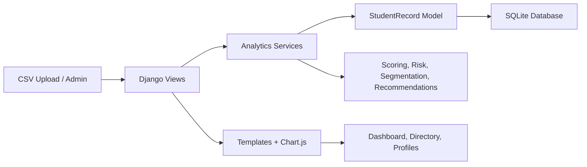

# Architecture

## Frontend and templates
The user interface is built with Django templates and a custom CSS design system to keep the dashboard responsive and accessible. Chart.js renders score distribution and other visual summaries directly from application data.

## Django backend
Django manages route handling, authentication, and the request lifecycle. The analytics app contains view logic for dashboard, directory, risk review, segmentation, and import workflows.

## Database and ORM
The project uses SQLite for local development and Django ORM models for student data. This keeps the application easy to run for demo purposes while remaining compatible with a PostgreSQL production migration.

## Analytics services
Business logic is separated into dedicated service modules that handle scoring, risk analysis, segmentation, recommendations, and CSV import validation.

## Import and integration flow
Uploaded CSV files are validated, normalized, deduplicated, and merged into the StudentRecord model. Invalid rows are rejected and summarized for the user.

## Access-control boundaries
Administrative actions are protected by Django authentication and admin routes. Uploaded student records are stored outside the public static path and are not exposed through public URLs.

## Data protection
Private uploads and local data remain in the project workspace and are excluded from public assets. All reports are generated from stored data and are intended for human review.

## Deployment considerations
The project is designed for future deployment behind a web server, with `DEBUG=False` and environment-based secret configuration recommended for production. PostgreSQL is the recommended production database.
